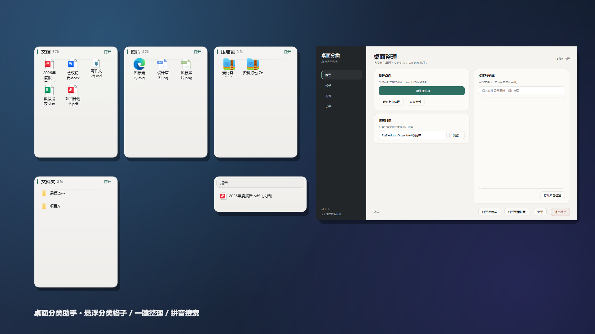
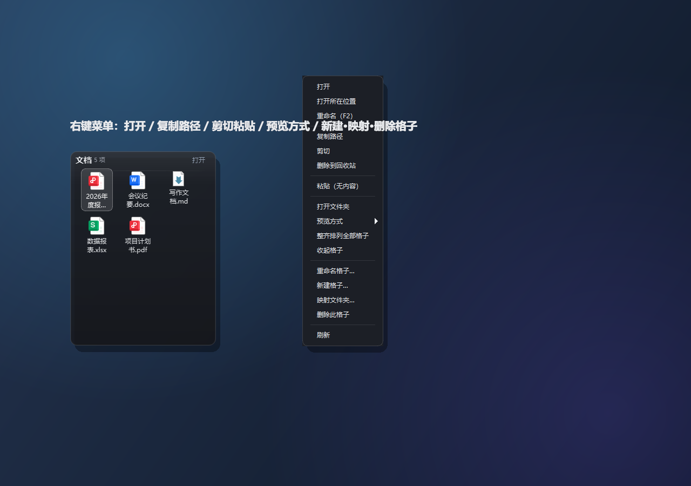
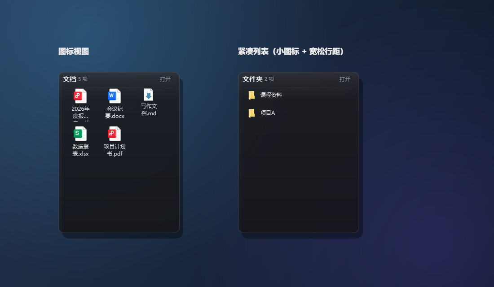

# 桌面分类助手

**当前版本：v2.10.0** ｜ [更新日志](CHANGELOG.md)

一款面向 Windows 的桌面文件整理工具（Python + PySide6）：
桌面悬浮一排半透明**分类格子**，一键整理桌面文件，支持拖拽收纳 / 取出、
批次撤销、收纳库搜索与拼音检索、路径映射、游戏模式等。



## 功能特性

- 🗂 **悬浮分类格子**：显示真实系统图标；图片条目直接显示**内容缩略图**；支持"图标视图 / 紧凑列表"两种预览方式，每个格子独立切换
- 🖱 **拖拽操作**：文件/文件夹拖入格子即收纳；格子内可多选拖出到桌面、资源管理器或其它格子；支持格子间剪切粘贴
- 🏷 **条目重命名**：格子内的文件/文件夹可右键「重命名（F2）」或按 `F2` 键就地改名（非法名称 / 重名会被拦截，不会覆盖已有文件）
- ✨ **一键整理**：按扩展名把桌面顶层文件/文件夹分类移入收纳库；整理前弹出预览确认；所有移动批次化记录，可"撤销上次"或"恢复全部"
- 🔍 **搜索**：常驻桌面的**扁平搜索条**（平时只有一个搜索框的高度，有结果时向下展开）与控制面板均可搜索收纳库，支持拼音全拼与首字母（输入 `bg` 即可找到"报告"）；搜索在后台线程执行，不卡界面，结果带分类标签
- 📐 **自由的布局**：八方向拖拽调整大小、拖动时智能对齐参考线、位置 / 尺寸 / 预览方式 / 缩放独立记忆
- 🧲 **一键整齐排列**：托盘菜单 / 右键即可把全部格子排成规整栅格（**统一 16px 间距**、列边与行顶对齐、越界自动归位）；新格子自动排队落位
- 🗜 **收起格子**：双击标题栏（或右键）收起 / 展开，收起后只剩一条标题，状态跨重启保留
- 🖱 **桌面右键一键整理**：桌面空白处右键 →「一键整理桌面」，不用先开控制面板（可在面板随时开启 / 关闭）
- ℹ️ **关于页**：详情介绍 / 更新日志 / 免责声明，收纳库与配置目录一键直达
- 🖥 **横向三栏控制面板**：整理操作 / 格子与开关 / 搜索·更新 一屏尽览
- ⬆️ **一键更新**：填写更新源后，点击即可检查新版本并自动升级（exe 版自动替换重启；源码版打开下载页）
- 📁 **路径映射**：把任意现有文件夹映射为桌面格子（文件原地不动，同样纳入监听与搜索）
- 🌙 **游戏模式**：隐藏全部格子并暂停文件监听，接近零资源占用；F7 / 托盘一键切换
- ⌨️ **全局热键**：`F7` 显示/隐藏格子、`F8` 控制面板、`F9` 游戏模式；托盘常驻、支持开机自启、单实例保护
- 🔄 **可选自动整理**：桌面新出现的文件静置指定时间后自动归位（默认关闭，不会动已有文件）
- 🧩 **自定义格子**：右键即可新建 / 重命名 / 删除格子；内置分类也可改名（只改显示名，自动整理与收纳库文件夹不受影响）
- 🚀 **快捷启动**：面板一键在桌面 + 开始菜单生成快捷方式（带图标与 `Ctrl+Alt+D` 组合键）；
  也可打包成**免安装独立 exe**，目标机器无需装 Python

## 截图

右键菜单：



两种预览方式：



> 截图由 `tools/make_readme_screenshots.py` 使用合成的演示数据生成，不含任何真实个人文件。

## 下载

- **最新版（GitHub Releases）**：<https://github.com/jokerXYH/desktop-organizer/releases/latest>
  免安装单文件 exe，双击即用；首次运行会在 exe 同级创建「收纳库」文件夹，资料都保存在本机。
- **应用内更新**：控制面板「版本与更新」→「检查更新」，exe 版可下载并自动替换重启。

## 运行

环境要求：**Windows 10/11**、**Python 3.9+**（依赖见 `requirements.txt`）。

```bash
pip install -r requirements.txt
python main.py
```

想更方便地启动，有两种方式：

```bash
# 方式一：在控制面板点「创建快捷方式（桌面 + 开始菜单）」，双击 .lnk 即启动
# 方式二：打包成免安装的独立 exe（目标机器无需装 Python）
pip install pyinstaller
python tools/build_exe.py            # 生成 dist/桌面分类助手_v<版本号>.exe
python tools/build_exe.py --console  # 保留控制台，便于排查启动问题
```

> 打包后收纳库默认建在 **exe 同级的 `收纳库` 目录**（不是临时解包目录），
> 与源码运行时行为一致，资料不会随程序退出丢失。

## 使用说明

- 双击格子内条目用系统默认程序打开；点右上角"打开"直接进入对应文件夹
- 格子内条目支持多选，右键菜单提供：打开、复制路径、剪切、删除到回收站、粘贴等
- 拖动格子右下角/边缘可调整大小；拖动时出现对齐参考线；位置与尺寸自动记忆
- 双击格子**标题栏**收起 / 展开；右键「整齐排列全部格子」（或托盘菜单）一键对齐所有格子
- 右键格子空白处可切换预览方式、重命名 / 新建 / 映射 / 删除格子
- 「一键整理」默认先预览再执行；面板中可关闭预览直接整理
- 一键整理有三个入口：控制面板按钮 / 托盘菜单 / **桌面空白处右键**（面板可开关）
- 面板「快捷启动」按钮可生成快捷方式；程序常驻托盘时按 `Ctrl+Alt+D` 唤起控制面板
- 面板底部「关于」可查看详情介绍、更新日志与免责声明
- 面板右栏「版本与更新」：填写更新源地址后，「检查更新」一键升级（exe 版自动替换并重启）
- 数据位置：收纳库为程序目录下的 `收纳库` 文件夹（可在面板中修改）；
  配置与历史记录保存在 `%APPDATA%\MyDeskOrganizer`

## 测试

```bash
python -m pytest tests/ -q    # 203 passed
```

## 项目结构

```
main.py            程序入口：应用上下文、托盘、全局热键、文件监听
organizer.py       分类 / 整理 / 撤销 / 移动 / 搜索（纯逻辑，无 GUI 依赖）
config.py          配置与历史记录的 JSON 持久化（纯逻辑）
shortcut.py        桌面 / 开始菜单快捷方式生成（纯逻辑，无 GUI 依赖）
search_service.py  收纳库搜索后台线程服务（面板与搜索格子共享）
autostart.py       HKCU Run 开机自启读写
widgets.py         格子窗口、搜索格子、对齐参考线、文件图标提取
control_panel.py   控制面板（整理、设置、搜索）
assets/            应用图标 app_icon.ico（快捷方式与打包 exe 共用）
tools/             开发辅助脚本（README 截图、应用图标生成、exe 打包）
tests/             203 个自动化测试
```
